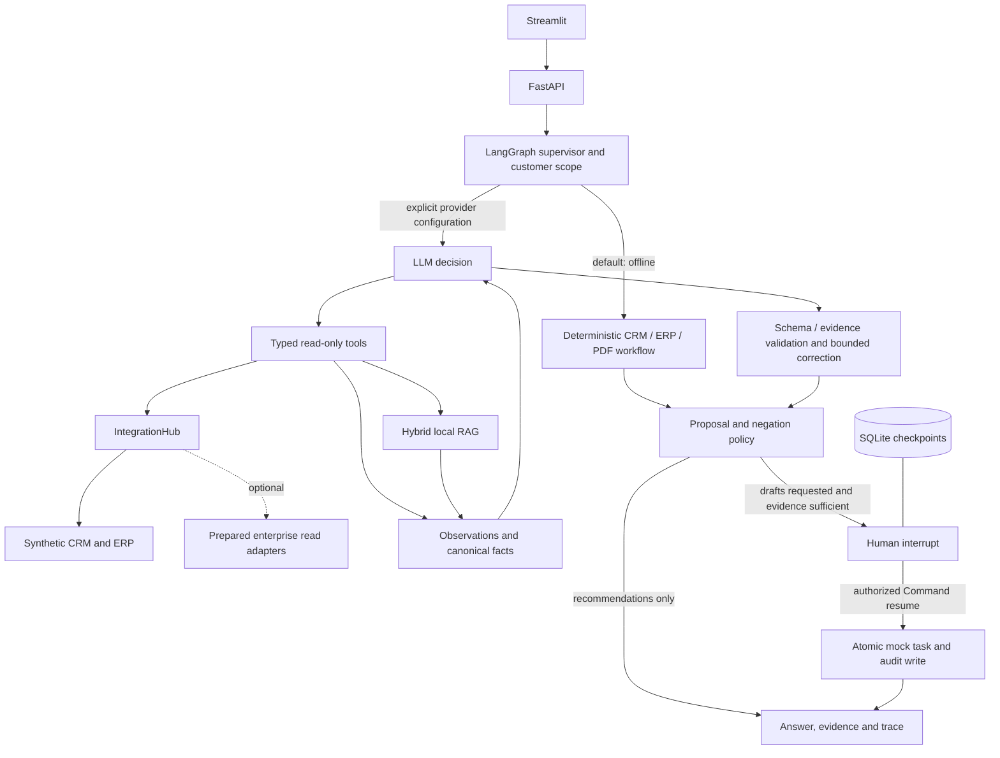
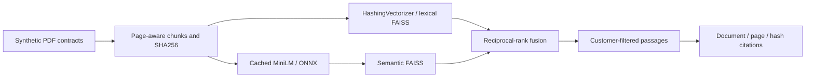

# Enterprise Agentic AI Copilot

Evidence-grounded CRM/ERP renewal operations with an offline demonstration and an optional bounded LLM supervisor. **AI Engineering portfolio prototype; not a production deployment.**

> **Offline deterministic demo — no generative LLM inference.**
> Default mode needs no API key, Ollama server or internet connection at runtime. Cached local embeddings are optional; missing semantic resources produce an explicit lexical fallback.

Account teams need to combine overdue invoices, support incidents and contract obligations before deciding how to follow up. This project joins those sources, shows each risk signal and its evidence, and requires an authorized human decision before persisting a synthetic CRM task.

Offline routing is deterministic. Optional LLM mode uses **one supervisor selecting Python tools**, not independent autonomous CRM/ERP/RAG LLM agents. Financial calculations and risk scoring remain deterministic in both modes.

## Architecture



## AI Engineering scope

- Bounded observe-decide-act loop, typed arguments, customer scope and provider telemetry.
- Exact claim validation, PDF provenance, contradiction detection and rejection of unsupported output.
- Compacted model context with complete persisted observations; evidence survives a subsequent tool error.
- At most three correction retries; native Ollama JSON-schema correction after sufficient evidence. Other providers retain Pydantic validation.
- Persistent human approval and transactional/idempotent effects. Model suggestions cannot authorize writes.
- Simulated transports are labeled explicitly. Historical real-model evidence is documented separately.

| Supervisor tool | Responsibility |
|---|---|
| `list_customers` | Discover customers by name or ID |
| `get_customer` | Account, contacts, commercial history and registry |
| `get_invoices` | Invoices/orders and exact overdue EUR cents |
| `get_tickets` | Support status and severity |
| `search_contracts` | Customer-scoped retrieval with source passages |

No model-accessible write or approval tool exists. Explicit prohibitions override `prepare_actions=True`.

## Run the offline demo

From the repository root, with the existing environment:

```powershell
$env:LLM_MODE = 'offline'
.\.venv\Scripts\python.exe launch.py
```

Open [Streamlit](http://127.0.0.1:8501) and [FastAPI docs](http://127.0.0.1:8000/docs). `LANCER.cmd` is the Windows launcher. Services bind to loopback; Ctrl+C stops the processes owned by the launcher.

Initial Python dependency setup (internet may be needed once):

```powershell
python -m venv .venv
.\.venv\Scripts\python.exe -m pip install -e ".[dev]"
if (-not (Test-Path .env)) { Copy-Item .env.example .env }
```

Use `requirements-lock.txt` instead for the recorded Windows/Python environment. Semantic dependencies are optional (`.[semantic]`); the lock includes them. No setup command automatically downloads model weights or installs a generative runtime.

### Reproducible scenarios

| Scenario | Steps / expected result |
|---|---|
| Portfolio | AI Copilot → baseline → **Run renewal-risk demo**. Inspect signals and paused proposals. |
| Comparison | **Compare C001 and C004 — recommendations only**. Scores 85/40; no proposal/task. |
| Contact / invoices | Ask `Who is the contact for C003?` or `Show invoices for C001`. Inspect records and routing. |
| Contract | Contract Knowledge → hybrid → C002 → `non-renewal notice`. Inspect PDF/page references; semantic mode needs a cached encoder. |
| Approval | Review the batch, enter reviewer/token, approve or reject. Public demo token: `local-demo-approver`, not production authentication. |
| Evidence | Traces & Evaluation shows nodes, citations, audit events and measured offline metrics. |

Selecting `hybrid` with `LLM_MODE=offline` means deterministic workflow plus learned retrieval, not generative reasoning. `baseline` never calls a provider, even if configured. Separate queries have separate threads; conversational memory is absent.

## Hybrid RAG



`sentence-transformers/all-MiniLM-L6-v2` produces 384-dimensional embeddings through FastEmbed/ONNX CPU. Loading is cache-only. Set `SEMANTIC_CACHE_DIR` to an existing compatible cache or use `data/models/`. Missing resources produce explicit lexical fallback. See [setup](docs/LOCAL_SETUP.md).

Provenance does not establish general semantic entailment. LLM claims must match observed canonical text. Supported expiry/notice/dispute conflicts and missing data withhold unsupported proposals.

## CRM/ERP integrations

| Adapter | Current scope |
|---|---|
| Synthetic CRM/ERP | Functional SQLite reads and approved mock tasks, tested locally |
| Salesforce CRM | Prepared read adapter; no live tenant tested |
| Dynamics 365 | Prepared Dataverse reads; no live tenant tested |
| SAP ERP | Prepared OData reads and explicit field/identity maps; no live tenant tested |
| Azure AI Foundry | Optional compatible provider/read preparation; not configured/live tested |

`IntegrationHub` selects mock or real. Enterprise modes default to mock. Unconfigured real mode fails instead of substituting synthetic data. Status distinguishes mock, unconfigured, configured-but-unverified and verified read. HTTP fixtures cannot establish live status. Remote writes are absent. See [connector contracts](docs/CONNECTORS.md).

## Dataset and business rules

The fixed snapshot is **2026-10-21**, independent of the audit date: 30 customers, 30 two-page PDFs, 87 invoices, 90 tickets, contacts, opportunities, interactions and orders. C005 deliberately has incomplete evidence. Contact emails use `.invalid`.

Money uses integer EUR cents. Prioritization combines overdue payments (20/35), critical support (25), renewal within 60 days (20), dispute (15) and stalled opportunity (5). This is a rule score, not learned churn probability. Offline recommendations use a playbook; the optional LLM selects eligible actions and fact IDs. Action labels are controlled templates.

## Human-in-the-loop

`SqliteSaver` checkpoints each thread. `interrupt()` precedes execution; an authorized decision resumes through `Command(resume=...)`. Task, decision and audit writes are atomic; unique fingerprints prevent repeated committed actions. Tests cover process restart, rejection, duplicate decisions, token authorization, cross-run binding and negations.

Tasks are persistent local rows representing **mock CRM operations**, never Salesforce/Dynamics API writes.

## Optional LLM providers

Keep `LLM_MODE=offline` for normal use. Adapters remain available for future deliberate use. This finalization does not start/query/modify Ollama, download models or contact external providers.

| Provider | Explicit configuration |
|---|---|
| Ollama | `LLM_MODE=ollama`, `LLM_PROVIDER=ollama`, `OLLAMA_BASE_URL`, `OLLAMA_MODEL` |
| OpenAI-compatible | `LLM_MODE=openai`, `LLM_PROVIDER=openai`, base URL, model and key |
| Azure OpenAI v1 | `LLM_MODE=azure`, `LLM_PROVIDER=azure`, resource endpoint, deployment and key |

All remain environment-configurable. External fields in `.env.example` are blank. Unavailable providers report fallback or safe failure; per-run metadata reports actual execution. See [optional settings](docs/LOCAL_SETUP.md).

## Testing and evaluation

```powershell
.\.venv\Scripts\python.exe scripts/verify_offline.py
```

Runs Ruff, dependency checks, full Pytest collection, offline API/workflow evaluation, cached RAG evaluation, approval restart and Streamlit AppTest. See [actual results](reports/public/validation.json), [publication checks](reports/public/publication-check.json) and [final audit](docs/FINAL_PORTFOLIO_AUDIT.md).

Verified on Windows / Python 3.10.11 on **2026-10-24: 102 passed, 7 skipped, 0 failures/errors**. All seven verification commands passed. Cached hybrid retrieval reached Recall@1/3 and MRR 1.00 on 12 development queries (lexical: 0.75). The [actual launcher smoke](reports/public/launch-smoke.json) also returned HTTP 200 for both services and API documentation, with offline mode confirmed.

Real-provider tests skip **before discovery** unless explicitly enabled with `--run-live-llm`. Ordinary tests reject unmocked HTTP transports. No live-provider command is part of verification. The 12-question retrieval development set is small, filtered and templated, not a held-out production benchmark. See [methodology](docs/EVALUATION.md).

[Historical Ollama evidence](reports/public/historical-ollama-evidence.json) retains timestamps and hashes from 2026-10-21. Individual passes occurred across different runs/revisions. No complete green live suite, current-revision model reliability, live-provider UI run or live bilingual-negation validation is claimed.

## Structure and technologies

```text
copilot/              graph, providers, tools, scoring, RAG, persistence and API
config/               non-secret integration mapping examples
tests/                offline, simulated-provider and opt-in live tests
scripts/              verification, UI smoke and restart checks
data/contracts/       small synthetic PDF fixtures
reports/public/       reviewed portable results and historical summaries
docs/                 architecture, setup, evaluation and final audit
licenses/             upstream notices
```

Python, LangGraph, SQLite checkpoints, FastAPI, Streamlit, Pydantic, httpx, FAISS CPU, scikit-learn, FastEmbed/ONNX, pypdf, ReportLab, Pytest and Ruff. Private configuration, environments, caches/weights, databases, installers, logs and raw machine-specific reports are ignored by Git.

## Limits, screenshots and attribution

No production SSO/RBAC, distributed coordination, remote writes, OAuth refresh, OCR, neural reranker or general entailment validation. Policies are conservative and pattern-based. Optional model behavior is not guaranteed. Docker/Compose is retained but not verified here. See [limitations](docs/LIMITATIONS.md).

Use [screenshot instructions](docs/SCREENSHOTS.md) to capture the actual offline interface. No stale image is presented as a current run. [GitHub description and topics](docs/GITHUB_PUBLICATION.md) are provided; nothing is pushed automatically.

Inspired by [AzureCosmosDB/multi-agent-langgraph](https://github.com/AzureCosmosDB/multi-agent-langgraph) and [javierherrera1996/langgraph-salesforce-sap-demo](https://github.com/javierherrera1996/langgraph-salesforce-sap-demo). No source module is imported from either archive. See [attribution and license caveat](THIRD_PARTY_NOTICES.md), [Microsoft's MIT notice](licenses/Azure-MIT.txt) and this project's [MIT license](LICENSE).
